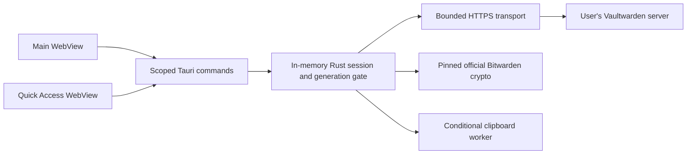

# Architecture

Veyra is a statically generated Nuxt 4 client in Tauri 2. It has no runtime Nuxt server and loads no remote content inside its privileged WebView. The frontend uses Vue Composition API and Pinia only for non-sensitive preferences.

## Authority and data lifecycle

Rust owns the connection, session token, SDK key store and encrypted ciphers. The server is selected explicitly; URLs require HTTPS, have no embedded credentials/query/fragment and preserve a reverse-proxy subdirectory. Redirects are not followed. Bodies, item counts and KDF work are bounded before use. A narrow literal-loopback HTTP exception requires a debug build and an explicit test environment flag; release builds cannot enable it.

The master password exists briefly in the Vue form/IPC input, is immediately cleared from form state and moved into `Zeroizing` in Rust. It is not persisted. Rust sends a derived authentication hash, initializes SDK crypto and performs the initial sync before declaring a connected session. SDK authentication is not used because its second prelogin fetch would undermine the single checked KDF budget. All cryptographic derivation, unwrap, cipher decryption and TOTP use official SDK operations; the project does not invent a cipher protocol.

Only bounded display metadata crosses general IPC. Passwords and TOTP codes require explicit scoped access; seeds, tokens, keys, notes and custom fields are excluded. Reveals expire and guard against lock/selection races. Both windows read the same native metadata snapshot and observe session events. Frontend state is not an authentication authority.

Locking cancels current work and advances a generation. Stale async login/sync completions cannot restore it. Tokens and SDK keys are dropped/cleared and metadata disappears in both windows. Session expiry also locks. No refresh-token persistence or offline unlock is claimed. Sync is read-only and transactional: parse/decrypt the complete supported personal snapshot before replacing the previous one. Organization/newer unsupported items are counted visibly, not represented as a complete vault.

## SDK and license decision

Veyra uses the published Bitwarden Rust SDK release `rust-v4.0.0` (2026-09-28). `bitwarden-core`, `bitwarden-crypto`, `bitwarden-vault` and API models are pinned to its exact commit `b865d1db0025d9d12bea871a3a131c05aaeed205`, rather than a later development snapshot. The repository and APIs remain internal and are not a public third-party compatibility guarantee. Secrets Manager SDK alone does not implement password-vault management. Selected SDK crates offer `GPL-3.0-only OR LicenseRef-Bitwarden-SDK`; Veyra selects GPL-3.0-only and licenses the combined application accordingly. Proprietary-only `bitwarden_license` paths are excluded. This does not establish upstream endorsement or compatibility with every Bitwarden/Vaultwarden deployment.

Supported account crypto is V1 with supported AES-CBC-HMAC envelopes and PBKDF2/Argon2id. Newer account states, unrecognized KDFs and failed integrity verification fail closed. The SDK's strict decryption feature flag is checked explicitly so a changed SDK flag cannot silently enable lenient decoding. Updates require a deliberate source-pin review and server matrix tests.

Sources: https://github.com/bitwarden/sdk-internal/releases/tag/rust-v4.0.0 , https://github.com/bitwarden/sdk-internal/tree/b865d1db0025d9d12bea871a3a131c05aaeed205 , its root LICENSE/LICENSE_GPL.txt, and https://github.com/dani-garcia/vaultwarden .

## Delivery boundaries

Flatpak uses a maintained GNOME 51 runtime. The current manifest packages a prebuilt native binary offline; this is offline packaging, not yet a fully vendored source build in the SDK sandbox. CI installs and functionally smoke-tests the bundle before publication. Global shortcut portals, browser Native Messaging, offline encrypted storage, editing and conflict resolution remain separate milestones.
